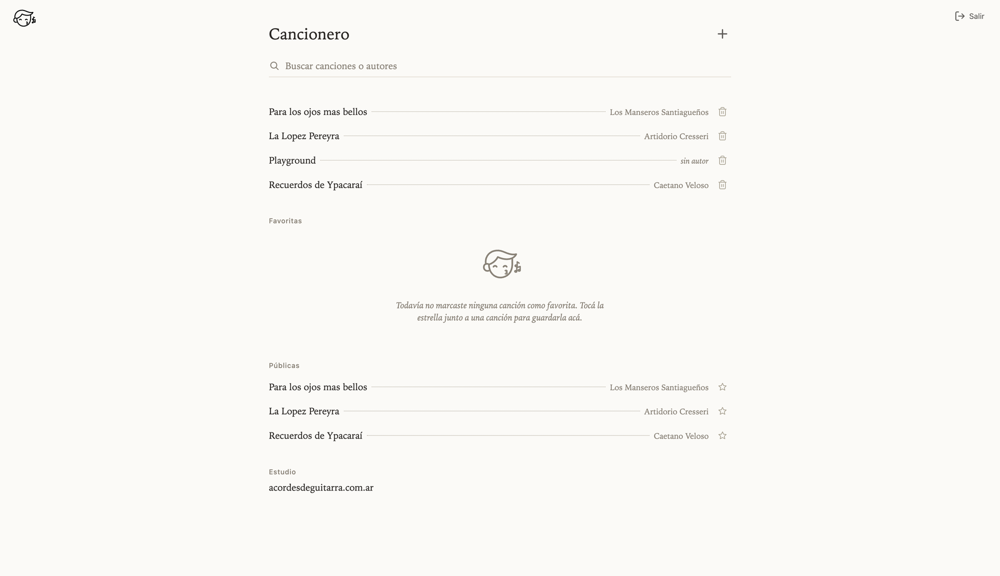
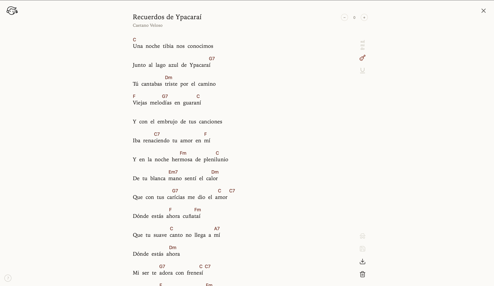

[](https://app.netlify.com/projects/elsilbador/deploys)

# El Silbador

Editor visual de anotaciones sobre sílabas de canciones (acordes, notas de canto). Ver
`.scratch/silabeo-editor/spec.md` para el spec completo.

Sitio: [elsilbador.com.ar](https://elsilbador.com.ar)

- `src/core`: lógica pura (silabeo, modelo de estado, reducer), sin dependencia de React/DOM.
- `src/app`: capa delgada de React + Vite que consume `src/core`.

## Capturas

<p>
  
  
</p>

## Desarrollo

```
npm install
npm run dev      # app en http://localhost:5173
npm run test     # tests del núcleo (vitest)
npm run build    # typecheck + build de producción
```

### Lighthouse

`npm run lighthouse` levanta un Supabase temporal (Docker) con una canción de prueba
(`supabase/lighthouse/seed.sql`), compila la app, la sirve y la audita con Lighthouse CI. Falla si
alguna página queda por debajo de los umbrales de `lighthouserc.json`; los reportes quedan en
`.lighthouseci/`. No toca el stack local compartido. En GitHub corre en cada PR y en cada push a
`main` (`.github/workflows/lighthouse.yml`), y los reportes se descargan como artefacto del job.

Los umbrales de las páginas con el editor de canciones son el puntaje actual, no el objetivo: al
corregir sus problemas de accesibilidad, subilos para que no vuelvan a bajar.

### Supabase Studio (local)

El proyecto incluye Supabase local (Docker) con Studio para inspeccionar y editar la base de datos desde el navegador.

```
npm run supabase:start   # levanta el stack local, incluyendo Studio
npm run supabase:stop    # lo apaga
```

Con el stack corriendo, abrí Studio en [http://localhost:54323](http://localhost:54323). Ver `supabase/README.md` para instrucciones de migraciones.

Los correos que genera Supabase local —por ejemplo, los enlaces mágicos para iniciar sesión— no se envían a una casilla real. Podés recibirlos e inspeccionar sus enlaces en [http://127.0.0.1:54324/](http://127.0.0.1:54324/), la bandeja de entrada local que se inicia junto con el stack.

#### Migraciones

Con el stack local iniciado, aplicá únicamente las migraciones pendientes a tu base local:

```
npx supabase migration up --local
```

Para comprobar cuáles están aplicadas localmente, usá `npx supabase migration list --local`.

Para aplicar las migraciones pendientes al proyecto de producción, primero verificá que el repo
esté vinculado al proyecto correcto y después ejecutá:

```
npx supabase link
npx supabase db push
```

`supabase db push` modifica la base remota. Revisá las migraciones pendientes antes de confirmarlo;
no uses `--local` para producción.

#### Si Docker está activo pero `127.0.0.1:54321` rechaza la conexión

Esto puede ocurrir después de mover o renombrar el directorio del proyecto: un contenedor local
puede conservar una ruta anterior y el gateway de Supabase no llega a iniciar. Recreá los
contenedores sin borrar la base local:

```
npm run supabase:stop
npm run supabase:start
```

No agregues `--no-backup` al comando de stop, porque elimina los volúmenes con los datos locales.
Finalmente, reiniciá `npm run dev`. `npx supabase status` debe mostrar todos los servicios activos,
incluido `supabase_kong_<project-id>`.
